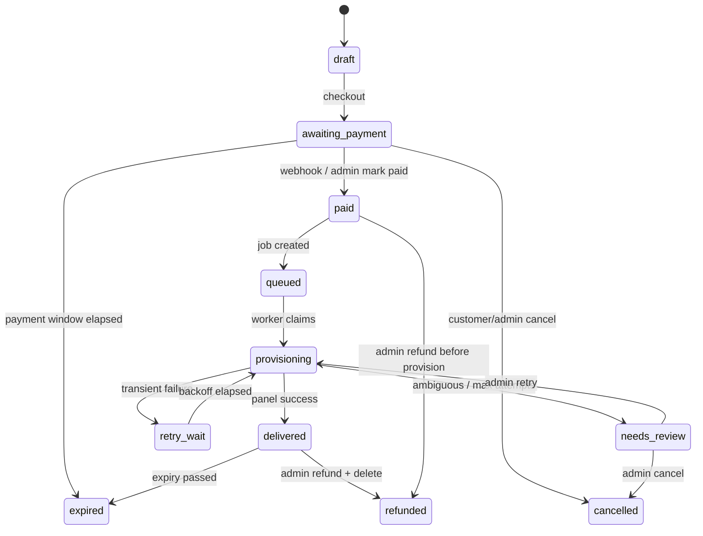
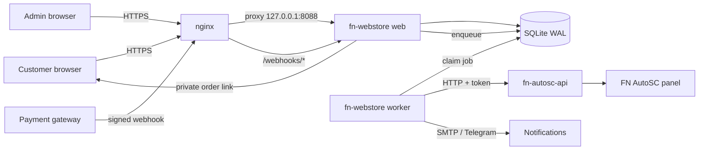

# fn-webstore — Project Plan

| | |
| :-- | :-- |
| **Status** | Phase 0 — planning (this repository) |
| **Owner** | `rohjagad` |
| **Last updated** | 2026-11-02 |
| **Depends on** | `rohjagad/fn-autosc`, `rohjagad/fn-autosc-api` |
| **Currency** | IDR (v1) |
| **Deployment** | Single VPS, same host as the panel recommended |

---

## 1. Problem

Today a VPN order is handled by a human:

1. A customer asks on WhatsApp/Telegram.
2. The operator opens the FN AutoSC menu.
3. The operator creates an account, choosing protocol, transport, days,
   quota and IP limit.
4. The operator copies the account card and sends it back.
5. The expiry is remembered manually.

That is slow, error-prone, impossible to audit, and does not scale past a
handful of orders per day. There is no payment record, no order status, no
renewal reminder, and no way to tell whether a paid customer actually received
a working account.

`fn-autosc-api` already exposes the panel's create/list/renew/delete actions
over HTTP, and `fn-autosc/project-information/fn-api.md` explicitly says the
API was restored for a planned web UI. `fn-webstore` is that UI and the
automation around it.

---

## 2. Goal

A customer can buy a VPN plan at any hour, pay, and receive credentials
without an operator touching the panel. The operator gets a single dashboard
for orders, failures, renewals and expiries.

### Success metrics for v1

| Metric | Target |
| :-- | :-- |
| Paid order to delivered account | p95 under 2 minutes |
| Paid orders silently unfulfilled | 0 |
| Duplicate accounts for one order | 0 |
| Orders needing manual intervention | under 1% |
| Payment webhook processing success | 99.5% |
| Customer page available during panel outage | yes (cached order state) |

---

## 3. Non-goals for v1

- Replacing the FN AutoSC panel or its menus.
- A multi-tenant SaaS for other operators.
- Mobile apps.
- Card acquiring or storing card data; the payment gateway handles that.
- Full accounting, tax reporting or invoicing compliance.
- Selling account types the panel cannot automate (WireGuard, L2TP,
  SlowDNS, OpenVPN-only, Shadowsocks, Socks5).
- Live chat, ticketing or a full CRM.
- Multi-currency and multi-language (the schema leaves room, the UI does not).

---

## 4. Users and jobs

### Customer (guest checkout)

- Compare plans without an account.
- Buy a plan with a username of their choice or an auto-generated one.
- Pay with QRIS/e-wallet/bank transfer.
- Return to a private order page to see status and credentials.
- Receive credentials by email and/or a shareable order link.
- Renew before expiry; get reminders.
- Ask for help with a clear order reference.

### Operator / admin

- See revenue, pending orders and provisioning failures at a glance.
- Create/edit products and prices without editing code.
- Mark a manual payment as paid, retry a failed provision, cancel/refund.
- See the exact panel call and error for a failed order.
- Reconcile the store's mirror against the panel.
- Manage panels, notification settings and admin users.
- Audit who changed what and when.

### Panel API (machine)

- Receive one authenticated, serialized request at a time.
- Create/renew/delete/list accounts.
- Never be called directly from a browser.

---

## 5. Product scope

### 5.1 Plans

A **product** is a sellable plan. It fixes:

| Field | Example |
| :-- | :-- |
| Protocol | `ssh`, `vmess`, `vless`, `trojan`, `noobz` |
| Transport (`core`) | `ws`, `http`, `xhttp`, `grpc`; empty for SSH/Noobz |
| Duration | 7, 30, 60, 90 days |
| Quota | 50 GB (Xray only) |
| IP limit | 1, 2, 3 |
| Price | IDR amount |
| Panel | which panel will fulfil it |

The set of products is data, not code. The operator can add a “VLESS WS 30
days / 100 GB / 2 IP” plan from the admin UI.

### 5.2 Supported combinations

| Product | `core` | Create endpoint | Renew | Delete |
| :-- | :-- | :-- | :-- | :-- |
| SSH | — | `/addssh` | `/renew-ssh` | `/delete-ssh` |
| VMess | `ws`/`http`/`xhttp`/`grpc` | `/add-vmess` | `/renew-xray` | `/delete-xray` |
| VLESS | `ws`/`http`/`xhttp`/`grpc` | `/add-vless` | `/renew-xray` | `/delete-xray` |
| Trojan | `ws`/`http`/`xhttp`/`grpc` | `/add-trojan` | `/renew-xray` | `/delete-xray` |
| NoobzVPN | — | `/add-noobz` | none (v1) | `/delete-noobz` |

NoobzVPN has no renew endpoint in the current API, so a NoobzVPN renewal is
handled as a new order only after the old account is deleted, or deferred
until an API endpoint exists. The product editor must prevent selling a
NoobzVPN “renewal” in v1.

### 5.3 Usernames

- Default: generated by the store, e.g. `fn` + 8 lowercase base32 characters.
- Optional: customer-chosen, validated against the **panel's own rules**:
  - SSH: `^[a-z][a-z0-9_]{0,31}$`
  - Xray: `^[a-z0-9_]{1,32}$` (the API accepts underscores, the panel's own
    scripts are stricter in places; the store applies the stricter shared
    rule and tests each product)
  - NoobzVPN: `^[a-zA-Z0-9_]{1,16}$`
- A username is unique per panel in the store and checked against the panel's
  `list-*` output before payment. The panel remains authoritative at
  provisioning time; a collision is handled by reconciliation, never by
  silently creating a second account.
- Custom usernames are a convenience, not a guarantee. The order page states
  that a suffix may be added if the name is taken in the panel.

### 5.4 Excluded until the API grows

| Product | Why not |
| :-- | :-- |
| WireGuard | panel has a menu but no API handler |
| L2TP / IPsec | same |
| SlowDNS / DNSTT | same |
| OpenVPN-only | no dedicated endpoint; the SSH endpoint creates a system user |
| Shadowsocks | no backend in the panel or either reference |
| Socks5 | no backend |

Adding any of these requires a new handler in `fn-autosc-api` first, then a
row in the endpoint table in `fn-autosc/project-information/fn-api.md`, then a
new product type here.

---

## 6. End-to-end flows

### 6.1 Browse and checkout

1. Customer opens `/`, sees active products grouped by protocol.
2. Chooses a plan at `/p/{slug}`.
3. Fills in name, email, optional WhatsApp/Telegram, optional username.
4. Accepts the terms; browser posts to `POST /checkout` with a CSRF token and
   an idempotency key.
5. Server validates the product and username, snapshots name/price/terms into
   the order, creates `orders` + `payment_intent`, and redirects to the
   private order page.
6. The order page shows the amount, payment method, QR/VA instructions and an
   expiry countdown.

No account is created at checkout. The panel is untouched until money is
confirmed.

### 6.2 Payment

**Manual provider:** instructions are shown; an admin clicks “Mark paid”.
`mark-paid` writes the same `paid` transition as a webhook, with an audit
event recording the admin.

**Automatic provider (Tripay first):**

1. `create_payment` asks the gateway for a QRIS/e-wallet/VA payment.
2. Customer pays.
3. Gateway sends a signed webhook to `/webhooks/tripay`.
4. The handler verifies the signature against the **raw body**, validates the
   merchant reference and amount, inserts a `payment_events` row with a unique
   `(provider, event_id)`, then in one transaction:
   - sets `payment_status = paid`, `paid_at`;
   - sets `fulfillment_status = queued`;
   - inserts a `provision` job;
   - writes an `order_events` row.
5. The handler returns HTTP 200 quickly. Provisioning happens in the worker.
6. A browser return URL is only a hint. It never marks an order paid.

If the gateway retries a webhook, the unique event row makes it a no-op.
If the webhook arrives before the local payment intent is committed, the
event is stored as unmatched; a reconciliation job matches it by provider
reference and applies it once.

### 6.3 Provisioning

1. Worker claims one queued job with `BEGIN IMMEDIATE` (single worker, but the
   claim is still atomic).
2. Sets `fulfillment_status = provisioning`, records an event.
3. Calls the panel API with the order's protocol/transport and the fixed
   username.
4. On success, stores the account mirror (credentials, links, expiry), sets
   `delivered`, writes an event, and enqueues delivery notifications.
5. On a domain error such as “username already exists”, it **does not** retry
   blindly; it runs reconciliation (section 6.7).
6. On a network timeout, it also reconciles. It never assumes failure.
7. On transient failure, it schedules `retry_wait` with exponential backoff
   (30 s, 2 min, 10 min, 30 min, 2 h), up to 5 attempts. After that,
   `needs_review` and an admin alert.

### 6.4 Delivery

The account credentials are available on the order page immediately. The
worker also enqueues:

- an email with the order page link and a short credential summary;
- an admin notification (Telegram and/or email);
- an optional WhatsApp click-to-chat link for the customer.

Credentials are **not** put in the email body in full when the order page is
available; the email contains the private link. The order page shows the
account card, links, QR (for compatible clients) and copy buttons.

### 6.5 Renewal

1. Customer opens the order page and clicks “Renew”.
2. Store checks the account mirror: protocol must support renew and the
   account must still exist in the panel.
3. A renewal order is created, linked by `renewal_of_order_id`, with a new
   payment intent.
4. On payment, the worker calls `/renew-ssh` or `/renew-xray` with the number
   of days, keeping usage (the API calls the panel's extend script with
   “reset quota = n”).
5. The account mirror's expiry is updated from the API's `expired` field and
   the computed order date; both are stored.
6. If the panel account has already been deleted by expiry, the store marks
   the renewal impossible and offers a new-account order instead.

### 6.6 Expiry and reminders

- The panel's `xp` cron deletes accounts past their expiry. The store's mirror
  is updated by a periodic `reconcile` job.
- Reminder jobs run daily and enqueue messages at D-7, D-3 and D-1.
- An account whose `expires_at` has passed is shown as expired; the panel
  `list-*` result is authoritative.
- The store never deletes a panel account automatically for expiry; that is
  the panel's job. It may delete an account only for an explicit cancel/refund
  or a failed-provision cleanup.

### 6.7 Failure and reconciliation

The API has no idempotency key and no “get one account with links” endpoint.
The store therefore treats a create call as **ambiguous** when the connection
drops or times out:

1. `GET /list-xray` or `/list-ssh` (and `/list-noobz` where relevant).
2. If the username is absent: the create did not land; retry normally.
3. If the username is present and the order has no stored credentials:
   the account belongs to this order (the username was reserved for it).
   - For SSH, the store can reset the password with `/password-ssh` if needed.
   - For Xray, the UUID/links are unrecoverable from the list. The safe path
     is `/delete-xray`, then a fresh create with the same username. The
     customer has not received credentials yet, so nothing is lost.
   - If deletion partially fails, set `needs_review`; never create a second
     account.
4. If the username is present and credentials are already stored: mark
   delivered; the first attempt succeeded.
5. If the panel has an account with the same username that is not linked to
   this order: do not touch it; pick a new suffix for this order and record
   the change.

A future `fn-autosc-api` improvement is an idempotency key and a
`get-account` endpoint. Until then, the delete-and-recreate path above is the
documented recovery. See `docs/PANEL-INTEGRATION.md`.

### 6.8 Cancel, refund and chargeback

- Unpaid orders expire automatically after the payment window.
- A paid but not-yet-provisioned order can be cancelled by an admin; the job
  is cancelled before it runs.
- A delivered order is refunded only by an admin action. The account is
  deleted first (`delete-*`) and the refund is recorded; if deletion fails,
  the refund is blocked or flagged for manual review.
- A gateway chargeback sets `payment_status = refunded` and opens a
  `needs_review` case; the store does not auto-delete on a chargeback without
  an admin decision.

---

## 7. Order state model

Payment and fulfilment are separate fields. This avoids the common bug where
“paid” and “delivered” are one status and a failed provision looks unpaid.



`payment_status`: `unpaid`, `paid`, `expired`, `refunded`, `failed`.
`fulfillment_status`: `pending`, `queued`, `provisioning`, `retry_wait`,
`delivered`, `needs_review`, `cancelled`.

The transition table and invariants are in `docs/ARCHITECTURE.md`.

---

## 8. Architecture at a glance



- **Web process:** storefront, order pages, admin, webhooks. Threaded HTTP,
  SQLite WAL, short transactions.
- **Worker process:** exactly one; claims jobs, calls the panel, writes
  results. Enforced with a process lock in addition to the atomic DB claim.
- **Maintenance process/timer:** expiries, reminders, reconciliation, stale
  job recovery, payment reconciliation, backups.
- **nginx:** TLS, static files, rate limits, request size caps, `/admin`
  source allowlist (optional).
- **SQLite:** single file, WAL, `busy_timeout`, `foreign_keys=ON`, daily
  `.backup` snapshot. No Redis, no external queue, no Node/PHP runtime.

Why this stack:

- `fn-autosc-api` is Python stdlib + shell; the store can live on the same
  host with the same operational model.
- A store at this scale (tens to low hundreds of orders/day) does not need a
  message broker; a SQLite job table with an atomic claim is enough.
- Fewer moving parts means fewer credentials and fewer upgrade paths on a
  root-adjacent host.

---

## 9. Data model

See [`migrations/0001_init.sql`](../migrations/0001_init.sql) for the exact
schema. The main tables:

| Table | Purpose |
| :-- | :-- |
| `panels` | Panel base URL, token file path, active flag |
| `products` | Sellable plans and their panel mapping |
| `orders` | Immutable product snapshot, customer, money, payment and fulfilment state |
| `accounts` | Mirror of the account created in the panel; credentials and links |
| `payment_events` | Raw gateway events for dedupe and audit |
| `order_events` | Append-only timeline: created, paid, provisioned, failed, refunded |
| `jobs` | Durable queue: provision, notify, reconcile, expire, remind |
| `admin_users`, `admin_sessions` | Admin auth and sessions |
| `settings` | Small key/value configuration that is safe to keep in the DB |
| `schema_migrations` | Applied migration versions |

Sensitive data rules:

- `accounts.credentials_json` contains customer credentials. It is
  re-delivered only through the private order page or an admin action.
- The panel token is **not** in the database; it is read from a file at
  startup. A database copy is much easier to leak through backups.
- Payment secrets are environment/secret-file values, never DB rows.
- Order access tokens are stored as SHA-256 hashes, not plaintext.
- The SQLite file is mode `0600`, owned by the service user. Backups are
  encrypted before leaving the host.
- Application-level encryption of `credentials_json` is a Phase 5 hardening
  item; v1 relies on filesystem permissions and encrypted backups. This is
  recorded in ADR-007.

---

## 10. Public and admin interfaces

### 10.1 Public routes

| Method | Path | Purpose |
| :-- | :-- | :-- |
| GET | `/` | Storefront, active products |
| GET | `/p/{slug}` | Plan detail and checkout form |
| POST | `/checkout` | Create order + payment intent |
| GET | `/order/{public_id}` | Private order page (token in query or cookie) |
| POST | `/order/{public_id}/refresh` | Re-render status (rate-limited) |
| POST | `/order/lookup` | Email + invoice lookup, sends a fresh link |
| GET | `/order/{public_id}/invoice` | Printable invoice |
| POST | `/order/{public_id}/renew` | Create renewal order |
| POST | `/webhooks/{provider}` | Gateway callback (signature only) |
| GET | `/healthz` | Liveness |
| GET | `/readyz` | DB + config readiness |

### 10.2 Admin routes

| Method | Path | Purpose |
| :-- | :-- | :-- |
| GET/POST | `/admin/login` | Login |
| POST | `/admin/logout` | Logout |
| GET | `/admin` | Dashboard |
| GET | `/admin/orders` | Search/filter orders |
| GET | `/admin/orders/{id}` | Order detail + timeline + panel payloads |
| POST | `/admin/orders/{id}/mark-paid` | Manual payment |
| POST | `/admin/orders/{id}/retry` | Retry provisioning |
| POST | `/admin/orders/{id}/cancel` | Cancel |
| POST | `/admin/orders/{id}/refund` | Refund (delete account first) |
| POST | `/admin/orders/{id}/resend` | Resend notification |
| GET/POST | `/admin/products` | Product CRUD |
| GET/POST | `/admin/panels` | Panel CRUD + health |
| GET/POST | `/admin/settings` | Safe settings |
| GET | `/admin/audit` | Admin/order event log |

All admin POSTs require a CSRF token tied to the session. Role checks are
enforced server-side, not by hiding buttons.

### 10.3 Payment adapter

```python
class PaymentProvider(Protocol):
    name: str

    def create(self, order: Order) -> PaymentIntent: ...
    def parse_webhook(self, headers: Mapping[str, str], raw_body: bytes) -> PaymentEvent: ...
    def refund(self, order: Order, amount_idr: int) -> RefundResult: ...
```

`PaymentIntent` carries a provider reference, amount, currency, QR string or
checkout URL, expiry, and customer instructions. `PaymentEvent` carries a
provider event id, provider reference, status, amount, paid time and raw
payload. The handler core is provider-neutral; `manual` and `tripay` are the
first two adapters.

### 10.4 Notifications

| Channel | Use | Notes |
| :-- | :-- | :-- |
| Order page | source of truth for credentials | no third-party dependency |
| Email (SMTP) | order link, paid, ready, reminders | stdlib `smtplib` |
| Telegram Bot API | admin alerts and optional customer updates | bot token in env |
| WhatsApp click-to-chat | “message us” link with order reference | no unofficial gateway in v1 |

Every notification is a job with a dedupe key, so retries cannot spam the
customer. Failures are logged and retried; a notification failure never
changes the provision state.

---

## 11. Reliability rules

1. **Paid-order invariant.** A webhook that sets `paid` also inserts the
   provision job in the same transaction. There is no window where an order
   is paid but no job exists.
2. **Atomic claim.** Worker uses `BEGIN IMMEDIATE`; one job is claimed once.
3. **Single worker.** A file lock prevents two worker processes, even if
   systemd is misconfigured.
4. **No blind retry of creates.** Reconcile first (section 6.7).
5. **Idempotent webhooks.** Unique `(provider, event_id)`; duplicate events
   return 200 without changing state.
6. **Idempotent notifications.** Unique `(kind, dedupe_key)`.
7. **Stale job recovery.** A job stuck in `running` past its lease is returned
   to `queued` by maintenance with a reconciliation flag.
8. **Bounded calls.** Panel client timeout 200 s (the API handler timeout is
   180 s); payment and notification calls have their own shorter timeouts.
9. **Graceful shutdown.** Worker finishes or releases its current job on
   SIGTERM; systemd does not kill it mid-call by default.
10. **Backups.** Daily SQLite `.backup`, encrypted, off-host; restore tested
    monthly. Losing the DB loses the order history, not the panel accounts.

---

## 12. Security plan

The panel API token is equivalent to root on the VPN host. The webstore is
therefore treated as a privileged internal service, not a generic website.

| Threat | Control |
| :-- | :-- |
| Panel token theft | token file `0600`, dedicated service user, never in browser/logs/DB, loopback or private network |
| Forged payment webhook | signature over raw body, amount/currency check, unique event id, optional IP allowlist |
| Webhook replay | unique `(provider, event_id)`, processed marker |
| Order link guessing | 32-byte random token, SHA-256 hash at rest, constant-time compare, `Referrer-Policy: no-referrer` |
| Order enumeration | unguessable public ids, rate-limited lookup, no email-only access |
| Admin takeover | scrypt password hash, secure HttpOnly session cookie, CSRF, login rate limit, optional IP allowlist, optional TOTP later |
| XSS | auto-escaping templates, CSP without inline scripts where possible |
| SQL injection | parameterized queries only |
| CSRF | session-bound token on every state-changing form |
| Credential leak in logs | redact `Authorization`, passwords, links, tokens; structured logging allowlist |
| Database theft | `0600` file, encrypted off-host backups, minimal PII, retention policy |
| Abuse / spam checkout | nginx rate limit + application token bucket, payment required before panel call |
| SSRF | panel URL from config only, never from user input |
| Malicious file upload | none in v1; no upload endpoint |

Additional rules:

- HTTPS only; HSTS; `Secure`, `HttpOnly`, `SameSite=Lax` cookies.
- `Content-Security-Policy: default-src 'self'` with no third-party assets on
  the order page.
- Admin sessions expire after 12 hours; rotation on login.
- Secrets are read from environment or `0600` files, never committed.
- Separate panel token for the store (append a line to `/etc/xray/.key` and
  copy it to `/etc/fn-webstore/panel-token`), so it can be rotated without
  invalidating other API clients.
- Do not run the webstore as root. A dedicated `fnwebstore` user owns
  `/var/lib/fn-webstore` and reads only its own token copy.

---

## 13. Operations

### Deployment target

```text
/etc/fn-webstore/env                 0600  fnwebstore
/etc/fn-webstore/panel-token         0600  fnwebstore
/var/lib/fn-webstore/webstore.sqlite3 0600 fnwebstore
/var/backups/fn-webstore/            encrypted snapshots, off-host copy
```

### systemd units

- `fn-webstore.service` — `python3 -m fn_webstore serve`
- `fn-webstore-worker.service` — `python3 -m fn_webstore worker`
- `fn-webstore-maintenance.timer` — `python3 -m fn_webstore maintenance`

Examples are in [`deploy/`](../deploy). The worker unit has
`Restart=on-failure` and a graceful stop timeout longer than the panel client
timeout.

### nginx

- Terminate TLS at `store.example.com`.
- Proxy to `127.0.0.1:8088`.
- `client_max_body_size 1m` (webhooks and forms are small).
- Rate-limit `/checkout`, `/order/lookup` and `/webhooks/*`.
- Serve `/static/` directly with a long cache.
- Optional `allow`/`deny` on `/admin`.
- Set `X-Forwarded-For`/`X-Real-IP` and trust only the local proxy in the app.

### Backups

- `sqlite3 webstore.sqlite3 ".backup '/var/backups/fn-webstore/db-YYYYmmdd.sqlite3'"`
- Compress and encrypt with age/openssl, copy off-host.
- Keep 14 daily, 8 weekly, 6 monthly.
- Restore drill monthly; a backup that has never been restored is a hope.

### Observability

- Structured JSON logs to journald: request id, route, status, duration,
  order id, job id; never credentials.
- `/healthz` = process alive; `/readyz` = DB writable + config valid (the
  cached panel ping is added with the panel client in Phase 2).
- Admin dashboard counters: unpaid, paid-not-delivered, needs-review,
  delivered today, expiring in 7 days, failed webhooks.
- Alerts: any `needs_review`, any paid order older than 10 minutes without a
  delivered account, worker down, webhook signature failures, disk space,
  backup failure.

---

## 14. Testing strategy

| Layer | What |
| :-- | :-- |
| Unit | validation, state transitions, amount checks, signature verification, expiry math, username rules |
| DB | migrations from empty, idempotent re-run, foreign keys, unique constraints, WAL behavior |
| Panel client | fake HTTP server implementing `fn-autosc-api` success/error/timeout/duplicate shapes |
| Payment | fake provider create + signed/forged/replayed webhooks |
| End-to-end | checkout → webhook → worker → fake panel → order page shows credentials |
| Recovery | worker killed mid-call; ambiguous create; partial delete; duplicate webhook; stale job |
| Security | admin auth/CSRF, order token, XSS payloads, SQL injection attempts, rate limits |
| Contract | optional live staging panel: SSH + one Xray transport, create/renew/delete |
| Load | 100 queued orders, one worker; measure drain time and DB contention |

The test suite uses `unittest` and stdlib only. A fake panel is preferred over
mocking the client, so the HTTP contract itself is tested.

CI (GitHub Actions): Python 3.11 and 3.12, `unittest`, `compileall`, schema
check, docs link check. Ruff is optional and CI-only.

---

## 15. Delivery phases

| Phase | Scope | Exit criteria |
| :-- | :-- | :-- |
| **0. Plan** (this repo) | plan, architecture, panel contract, schema, walking skeleton | docs reviewed; open questions answered; repo pushed |
| **1. Foundation** | config, migrations, admin auth, product catalog, storefront read-only, health, logs | `initdb` + `serve`; catalog renders from DB; admin can log in; tests pass |
| **2. Manual commerce** | checkout, order tokens, manual payment, admin mark-paid, worker, panel client, SSH + one Xray product, order page, email | paid manual order creates a real account on staging; credentials visible; no duplicate on retry |
| **3. Automatic payments** | Tripay adapter, webhooks, dedupe, amount validation, payment reconciliation, refunds | sandbox QRIS payment auto-queues and delivers; forged/replayed webhook rejected |
| **4. Full catalog + renewal** | all Xray transports, NoobzVPN, renewals, expiry mirror, reminders | each product passes create/renew/delete against staging; reminders fire |
| **5. Hardening + deploy** | rate limits, CSP, backups, systemd/nginx, monitoring, load test, runbooks | fresh deploy in under 30 minutes; restore drill passes; 100-order drain succeeds |
| **6. Growth** | multi-panel, coupons, customer accounts, WhatsApp API, reseller API | only after v1 is stable |

Phase 2 is deliberately before automatic payments: the operator can sell
manually and prove provisioning before adding money automation.

---

## 16. Risks and mitigations

| Risk | Impact | Mitigation |
| :-- | :-- | :-- |
| API has no idempotency / get-account | duplicate or lost account after timeout | reconcile + delete/recreate; propose API idempotency key |
| Panel API is single-threaded | low throughput, queue backlog | one worker, queue, p95 target; multi-panel later |
| Panel token is root-equivalent | full host compromise | loopback, dedicated token, 0600, separate user, no browser access |
| Username collision with manual panel edits | failed provision | pre-check lists, generated default, suffix on collision, needs_review |
| Payment webhook outage | paid order not queued | gateway retries + scheduled payment reconciliation |
| Credential leakage via order link | account abuse | random token, hash at rest, no-referrer, optional expiry, admin revoke |
| SQLite write contention | web errors under load | WAL, short transactions, one worker, busy timeout; measure before scaling |
| Expiry mismatch between store and panel | wrong reminders/status | store raw API date + computed date; daily reconciliation |
| Refund after account delivery | free service | delete account first; block refund if delete fails |
| Legal/tax requirements | compliance gap | invoice fields and retention configurable; consult operator before launch |

---

## 17. Open questions

These need answers before Phase 2/3. Defaults are in brackets so work can
continue.

1. **Payment gateway:** Tripay, Midtrans, Xendit, or manual only at launch?
   [Tripay first, manual always available]
2. **Deployment:** same VPS as the panel, or a separate host?
   [same VPS, loopback API]
3. **Catalog and prices:** which plans, durations, quotas, IP limits?
   [operator fills via admin; examples only in docs]
4. **Branding/domain:** store name, domain, logo, terms, refund policy?
   [placeholder `store.example.com`]
5. **Notifications:** email only, Telegram, or a WhatsApp gateway?
   [email + Telegram admin + WhatsApp click-to-chat]
6. **Custom usernames:** allow customer choice or auto-generate only?
   [allow, with generated fallback]
7. **Multi-panel:** needed at launch?
   [schema-ready, UI single-panel in v1]
8. **Invoices/tax:** are formal invoices or tax IDs required?
   [simple printable invoice, no tax engine]
9. **NoobzVPN:** sell it in v1 even though renewal needs a new account?
   [yes, labelled as non-renewable]
10. **Credential retention:** how long after expiry should the order page keep
    credentials? [90 days, then redact credentials but keep the order record]

---

## 18. Definition of done for v1

- [ ] Customer can buy every listed product end-to-end without an operator.
- [ ] Manual and automatic payment paths both enqueue exactly one provision job.
- [ ] A paid order is never left without a job, even if the process crashes.
- [ ] Ambiguous create calls reconcile without duplicate accounts.
- [ ] Renewal works for SSH and all Xray transports.
- [ ] Expiry reminders and status reconciliation run daily.
- [ ] Admin can see, retry, cancel, refund and audit every order.
- [ ] Panel token never appears in browser output, logs or the database.
- [ ] Webhook forgery/replay tests fail closed.
- [ ] Fresh deployment and restore drill are documented and tested.
- [ ] Load test drains 100 orders without duplicate or lost accounts.

---

## 19. References

- [FN AutoSC README](https://github.com/rohjagad/fn-autosc/blob/main/README.md)
- [FN AutoSC API README](https://github.com/rohjagad/fn-autosc-api/blob/main/README.md)
- [FN-API reference](https://github.com/rohjagad/FN-API)
- [`fn-api.md` — the panel HTTP API](https://github.com/rohjagad/fn-autosc/blob/main/project-information/fn-api.md)
- [`is-decision.md` — panel design decisions](https://github.com/rohjagad/fn-autosc/blob/main/project-information/is-decision.md)
